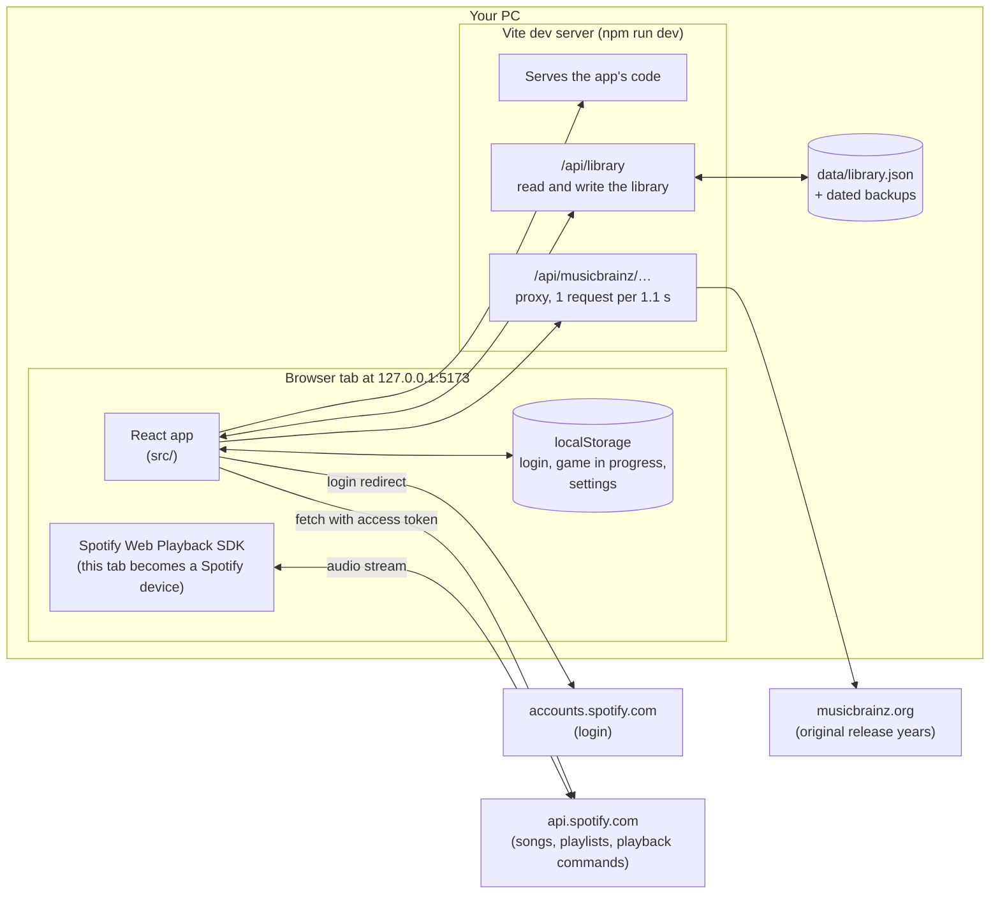
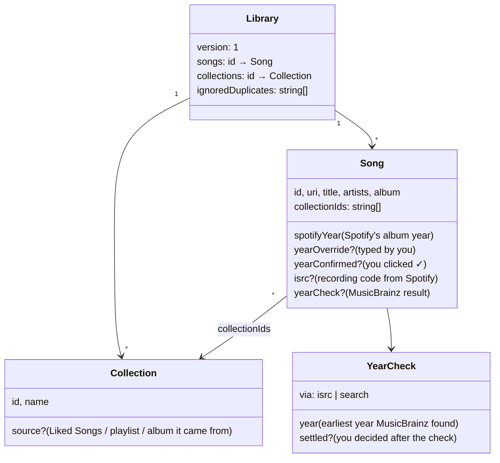
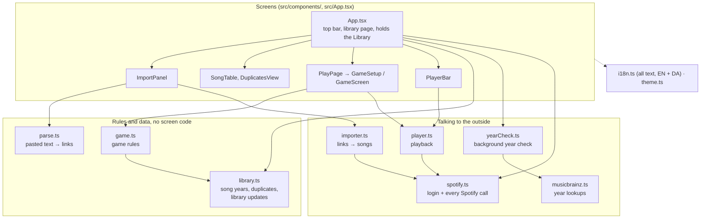
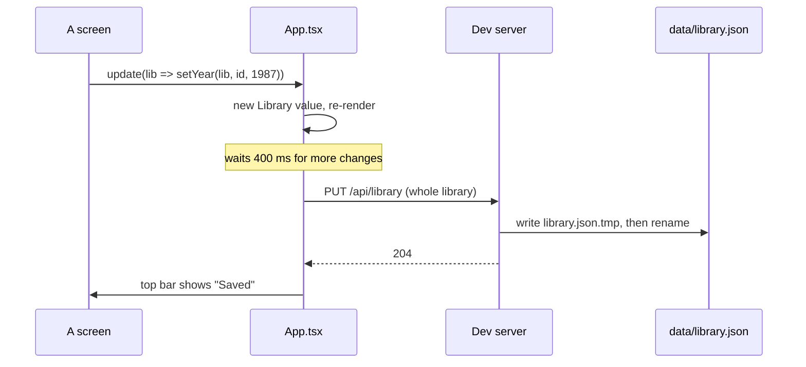
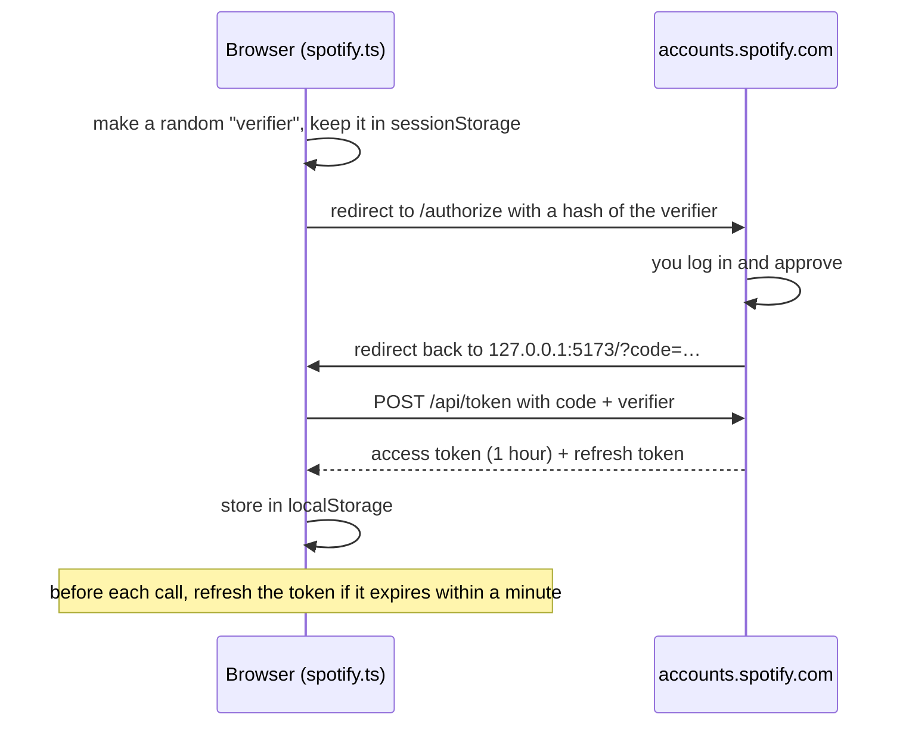
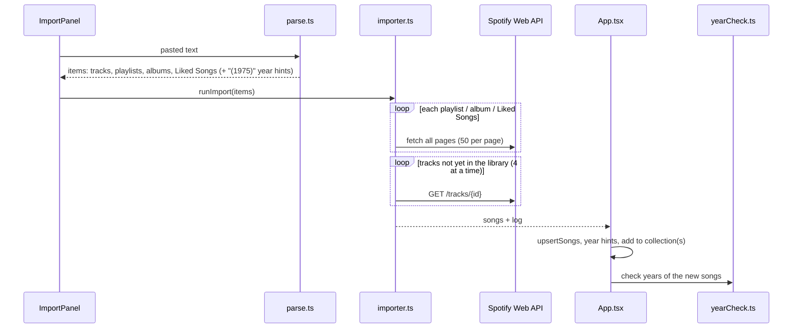
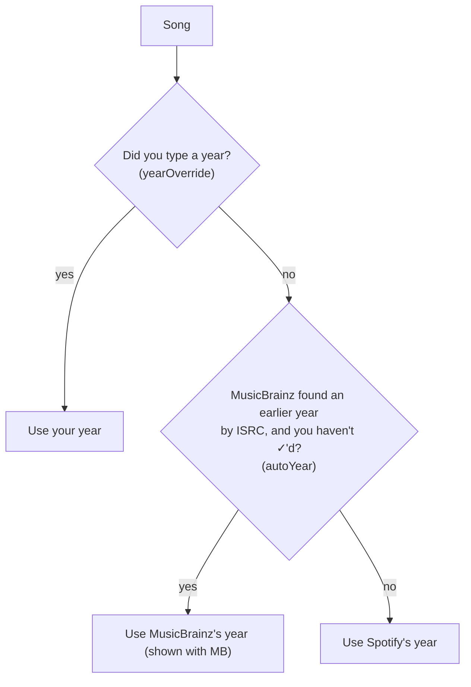
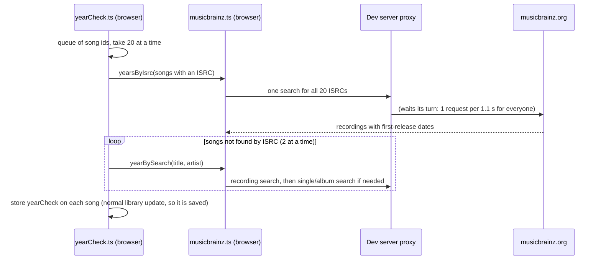
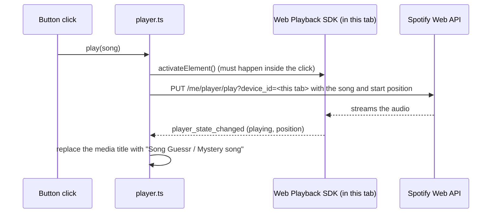
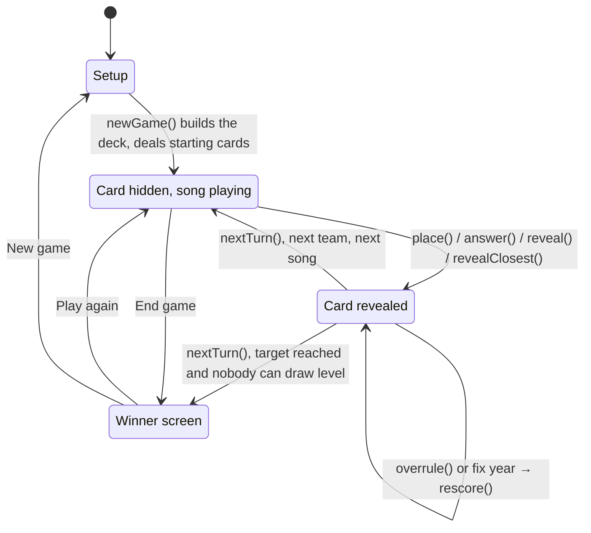

# How Song Guessr works

This explains what happens under the hood: what runs where, where the data lives, and how the main flows (login, import, year check, a game round) go through the code. [README.md](README.md) explains how to _use_ the app; this explains how it is _built_.

The diagrams are [Mermaid](https://mermaid.js.org/). GitHub draws them. In VS Code, install the "Markdown Preview Mermaid Support" extension to see them in the Markdown preview.

## 1. The big picture

Song Guessr is a **web page that runs in your browser** (React + TypeScript). There is no real backend: the "server" is the Vite **dev server** that `npm run dev` starts, plus two small add-ons in [vite.config.ts](vite.config.ts) and [server/musicbrainz.ts](server/musicbrainz.ts). That's why the app only works while `npm run dev` runs.

Three outside services, each reached differently:

| Service         | Who talks to it                            | Why that way                                                                                                                                |
| --------------- | ------------------------------------------ | ------------------------------------------------------------------------------------------------------------------------------------------- |
| Spotify login   | The browser, by redirecting the whole page | Standard OAuth "PKCE" flow: no secret is needed, so nothing secret is in the code.                                                          |
| Spotify Web API | The browser, directly                      | The login token lives in the browser.                                                                                                       |
| MusicBrainz     | The browser **via the dev server**         | MusicBrainz wants a `User-Agent` header (browsers can't set it) and about one request per second, which is easiest to enforce in one place. |

## 2. Where the data lives

| What                                                | Where                                                                   | Written by                               |
| --------------------------------------------------- | ----------------------------------------------------------------------- | ---------------------------------------- |
| The library: songs, collections, years, duplicates  | `data/library.json` (git-ignored)                                       | The browser, through `PUT /api/library`  |
| Backups of the library                              | `data/library.backup-<date>.json`                                       | The dev server, before a MusicBrainz run |
| Spotify login (access + refresh token)              | Browser `localStorage` (`sg.spotifyToken`)                              | [src/spotify.ts](src/spotify.ts)         |
| Game in progress, last setup, recently played songs | Browser `localStorage` (`sg.game`, `sg.lastSetup`, `sg.recentlyPlayed`) | [src/game.ts](src/game.ts)               |
| Theme, language, page, volume, playback device      | Browser `localStorage` (`sg.theme`, …)                                  | the module that owns each setting        |

So the **library is on disk** (survives a browser reset) and **everything about a game is in the browser** (survives a reload, but not a different browser).

The library's shape is in [src/types.ts](src/types.ts):

A song belongs to collections by listing their ids. Deleting a collection leaves the songs in the library.

## 3. Code map

| File                                                             | In one sentence                                                                                                                   |
| ---------------------------------------------------------------- | --------------------------------------------------------------------------------------------------------------------------------- |
| [src/main.tsx](src/main.tsx)                                     | Starts React; moves `localhost` to `127.0.0.1`.                                                                                   |
| [src/App.tsx](src/App.tsx)                                       | The top bar and the whole library page; owns the `Library` and saves it.                                                          |
| [src/types.ts](src/types.ts)                                     | The shapes of `Song`, `Collection`, `Library`.                                                                                    |
| [src/library.ts](src/library.ts)                                 | Everything you can do to a library (add songs, set a year, merge duplicates…), plus which year a song has and whether it gets ⚠. |
| [src/game.ts](src/game.ts)                                       | The game rules: building a deck, placing a card, scoring, whose turn it is, who won.                                              |
| [src/spotify.ts](src/spotify.ts)                                 | Login, token refresh, and every call to Spotify's Web API, with retries.                                                          |
| [src/player.ts](src/player.ts)                                   | Play / pause / seek / volume, in this tab or on another Spotify device.                                                           |
| [src/parse.ts](src/parse.ts), [src/importer.ts](src/importer.ts) | Turn pasted text into Spotify links, then the links into songs.                                                                   |
| [src/musicbrainz.ts](src/musicbrainz.ts)                         | Asks MusicBrainz for a song's original year (by ISRC, or by title + artist).                                                      |
| [src/yearCheck.ts](src/yearCheck.ts)                             | Works through a queue of songs in the background and stores each result.                                                          |
| [src/i18n.ts](src/i18n.ts)                                       | Every piece of visible text, in English and Danish.                                                                               |
| [server/musicbrainz.ts](server/musicbrainz.ts)                   | The dev server's MusicBrainz proxy: one queue, spacing, retries.                                                                  |
| [vite.config.ts](vite.config.ts)                                 | Dev server settings plus the `/api/library` read/write/backup add-on.                                                             |
| [e2e/](e2e/)                                                     | Playwright tests that drive the app in a real browser.                                                                            |

## 4. Three ideas the code is built on

**1. The library and the game are each one plain value, never changed in place.** Every change is a function that takes the old value and returns a new one, for example `setYear(lib, id, 1987)` in `library.ts` or `place(game, lib, slot)` in `game.ts`. The screens just call these and store the result. That keeps the rules in two files you can read on their own, without any screen code mixed in.

**2. Saving is automatic.** `App.tsx` keeps the library in React state. Whenever it changes, a timer waits 400 ms (so a burst of changes saves once) and then sends the _whole_ library to `PUT /api/library`. The dev server writes it to a temporary file first and then renames it over `library.json`, so a crash halfway through can't leave a broken file. The game is saved to `localStorage` on every change the same way.

**3. A few small "stores" live outside React.** The player, the year check, the theme and the language are each a module-level variable plus a list of listeners. Components read them with a hook (`usePlayer()`, `useYearCheck()`, `useTheme()`, `useT()`) and re-render when they change. That's how the player bar, the library and the game screen all see the same playback state without passing it around.

## 5. The main flows

### Logging in to Spotify

If the app later asks for a permission (scope) that the stored login doesn't have, the top bar shows **Reconnect Spotify** (`needsReconnect()`).

Every Spotify call goes through `apiRequest()` in `spotify.ts`. It retries after a `429 Too Many Requests` (waiting as long as Spotify asks), except when the app's whole quota is used up (`QUOTA_EXCEEDED`), where it stops at once. A `401` refreshes the token and tries once more.

### Importing songs

Songs already in the library are never fetched again. Importing a song that's already there refreshes its Spotify details but keeps everything you set (year, collections).

### Finding the right year

Spotify gives the **album's** year, which for a remaster or a hits compilation can be decades late. The app fixes this in layers. The year that is shown and used in games is decided by `songYear()` in `library.ts`:

A song gets **⚠** (`isYearSuspect()`) when a MusicBrainz suggestion is waiting for you, or, for songs MusicBrainz hasn't confirmed, when the album looks like a compilation or remaster.

The year check itself:

Rules worth knowing: a year from MusicBrainz is only ever used if it's **earlier** than Spotify's (a later one means the search missed the original). An ISRC match is the exact recording, so it's applied automatically; a title + artist match is only a **suggestion** you click. If MusicBrainz is busy, the proxy retries and the browser waits 20, 40, then 60 seconds before giving up. Before a bulk run started with the button, the dev server makes a dated backup of the library.

### Playing a song

When the app loads and Spotify is connected, the SDK registers the tab as a Spotify device called "Song Guessr". Browsers only allow sound after a click, which is why the next song in a game starts straight from the **Next** button's click handler. With another Spotify device chosen under **Play on**, the same commands go to that device instead, and the app polls its state every 3 seconds.

### A game

`PlayPage` shows `GameSetup` until you start, then `GameScreen`. All rules are in `game.ts`; the screen only calls them:

- **Deck:** `eligibleSongs()` takes the chosen collections and decades, and drops songs without a year (and ⚠ songs if you chose to). The deck is shuffled, with songs played in recent games moved to the back.
- **Scoring:** each round remembers the teams' scores from before it was scored (`round.before`). That's what makes **Count it as right / wrong** and **Fix year** possible: the round is simply scored again from that snapshot.
- **End of game:** `nextTurn()` lets the remaining teams in the round play only if they can still draw level, then goes to extra points and sudden death on a tie.
- **No spoilers:** the game screen never names the song before the reveal. The player bar gets no `titleFor`, game songs are marked `secret` so the library never shows them as playing, and the browser's media title is replaced.

## 6. Tests

`npm run test:e2e` runs Playwright tests in [e2e/](e2e/). They start their **own** dev server on port 5174 with a generated library in `e2e/.data`, block every request to Spotify, point MusicBrainz at a closed port (tests fake its answers), and pre-fill `localStorage` (for example a fake login or a game in progress). So they never touch your real library and can run while `npm run dev` is open. They also save screenshots to `e2e/.results/screens/`.

## 7. Where to look when…

| You want to…                                      | Look in                                                                                                                               |
| ------------------------------------------------- | ------------------------------------------------------------------------------------------------------------------------------------- |
| change any visible text                           | [src/i18n.ts](src/i18n.ts) (both `en` and `da`)                                                                                       |
| change a game rule or scoring                     | [src/game.ts](src/game.ts)                                                                                                            |
| change which year a song gets, or when it gets ⚠ | `songYear`, `autoYear`, `yearSuggestion`, `isYearSuspect` in [src/library.ts](src/library.ts)                                         |
| change how MusicBrainz is searched                | [src/musicbrainz.ts](src/musicbrainz.ts)                                                                                              |
| understand a Spotify error                        | `apiRequest` in [src/spotify.ts](src/spotify.ts), `describe` in [src/importer.ts](src/importer.ts) and [src/player.ts](src/player.ts) |
| change how the game screen looks                  | [src/components/GameScreen.tsx](src/components/GameScreen.tsx) and [src/styles.css](src/styles.css)                                   |
| change colours                                    | the tokens at the top of [src/styles.css](src/styles.css)                                                                             |
| restore an old library                            | copy a `data/library.backup-….json` over `data/library.json` while the app is closed                                                  |
